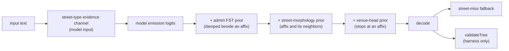

# Street affixes

A street affix is a word that marks a street's type or direction: `Street`, `Rd`, `Avenue`, `rue`,
`Calle`, `Straße`, `N`. The parser tags it `street_prefix` or `street_suffix`, and both tags are
children of `street` in [`SCHEMA.mdx`](../SCHEMA.mdx). The glossary reserves _designator_ for the
leading word of a unit phrase (`Apt`, `Suite`, `Floor`), which has its own page.

## The signals

Five mechanisms read street affixes. One is a model input, three are emission priors added to the
model's logits before decoding, and one runs after the parse. A sixth check, `validateTree`, runs
only in the dev harness.

| mechanism                    | where                                                      | what it does with an affix                                                                                               |
| ---------------------------- | ---------------------------------------------------------- | ------------------------------------------------------------------------------------------------------------------------ |
| Street-type evidence channel | `street-type-lexicon-v3.json` in each weights package      | Marks a matched word as a street type in one feature bit the model reads at its input.                                   |
| Admin FST damping            | `streetContextScale` in `packages/neural/lib/fst-prior.ts` | Multiplies a place-name match's admin bias by 0.25 when the match sits next to an affix or a house number.               |
| Street-morphology prior      | `packages/neural/lib/street-morphology-prior.ts`           | Adds bias toward `street_prefix` and `street_suffix` on the affix, and toward `street` on the nearest word on each side. |
| Venue-head prior             | `packages/neural/lib/venue/head-prior.ts`                  | Stops a venue head's bias from extending past an affix.                                                                  |
| Street-miss fallback         | `packages/mailwoman/lib/street/miss-fallback.ts`           | Retries a one-word street span as a locality when the geocode returned a null coordinate and no fork was declared.       |

### The street-type evidence channel

The weights package ships `street-type-lexicon-v3.json`, built by
`mailwoman gazetteer build street-type-lexicon` from the codex's FR, US, GB, DE and CA tables. Each
whitespace word is normalized and matched longest-first. Lowercase entries match case-insensitively,
and uppercase code entries such as `AVE` match only when the input is already uppercase.

The lexicon applies a digit guard. A match paints no evidence when any word in it, or the nearest
non-empty word beside it, contains a digit. The guard keeps the channel from pulling a house number
into a street span.

### The admin FST damping

The admin FST (the gazetteer place-name automaton) adds bias toward place tags on a matched name.
When that name sits next to a street affix or a house-number-shaped word, the bias is multiplied by
`positiveScale`, which defaults to 0.25. `Manchester Road` therefore gives `Manchester` a quarter of
its locality bias. The FST builder also never inserts a bare affix such as `boulevard` as a place
name, through its `excludeSurfaces` set.

### The street-morphology prior

`fst-street-morphology.bin` is built from libpostal's `street_types.txt` dictionaries. A match
writes these biases, in logits, before the decoder runs:

| cell                                                    | bias |
| ------------------------------------------------------- | ---: |
| the affix, `B/I-street_prefix` and `B/I-street_suffix`  |   +3 |
| the nearest word on each side, `B/I-street`             |   +2 |
| the nearest word on each side, `B/I-dependent_locality` |   −2 |

The prior raises both affix tags and leaves the choice between prefix and suffix to the decoder.
The `dependent_locality` penalty exists because street names otherwise drew that tag.

`findNeighbour` returns the nearest word group whose normalized token is non-empty. Whitespace and
punctuation groups are skipped, so the search crosses a comma.

## An affix with no street name

A dangling affix is an affix whose side has no street name word: it is the only word, or a comma
separates it from the words it would modify. The parser has no dedicated handling for it. Parses
observed under `en-GB` with the shipped weights on 2026-10-11, through `mwdev_diff_parse`:

| input                          | parse                                                            |
| ------------------------------ | ---------------------------------------------------------------- |
| `Road`                         | `street "Road"` (0.84)                                           |
| `High Street`                  | `street "High"`, `street_suffix "Street"`                        |
| `Museum Street`                | `street "Museum"`, `street_suffix "Street"`                      |
| `Manchester Art Gallery Road`  | `street "Manchester Art Gallery"`, `street_suffix "Road"`        |
| `Manchester Art Gallery, Road` | `street "Manchester Art Gallery"`, `street_suffix "Road"` (0.35) |
| `10 St, London`                | `house_number "10"`, `street "St"`, `locality "London"`          |
| `Avenue, Paris`                | `street_prefix "Avenue"`, `street "Paris"` (0.52)                |

Two patterns follow from the mechanisms above.

**A lone affix becomes the whole street.** `Road` and the `St` in `10 St, London` have no
neighboring word that could take the `street` tag, and the decoder tags the affix itself `street`.
The street-miss fallback acts on such a span only when the geocode returns a null coordinate.

**An affix across a comma takes its neighbor.** In `Manchester Art Gallery, Road` and
`Avenue, Paris`, the morphology prior's neighbor search crosses the comma and gives the venue name
and the city +2 toward `street`. The suffix is tagged at 0.35 confidence, and the venue name still
becomes a street span.

### After the parse

`validateTree` in `packages/core/lib/decoder/validate-tree.ts` lists `street_prefix` and
`street_suffix` in `STRICT_DEPENDENTS`. It reports a stranded-dependent violation when neither has
a `street` anywhere in the tree. Its only caller is the dev harness
(`packages/mailwoman/tools/dev-tools/harness-neural.run.ts`), so a production parse can return a
stranded affix to the caller.

## Open questions

- The venue-head prior stops at a segment break (`SEGMENT_BREAK_RE`) and the morphology prior's
  neighbor search crosses one. A board run with the neighbor search stopped at segment breaks
  would measure what the comma rule changes. Rows that write a comma inside a street are the
  population at risk.
- The board's count of rows containing a dangling affix is unmeasured.
- A decoder constraint could forbid a `street_suffix` with no `street`, or the tree builder could
  drop it. Either change applies at runtime what `validateTree` reports in the harness.
