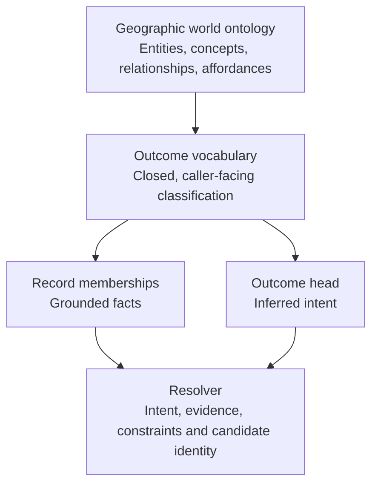

# Outcome kinds

A bare place name has several correct readings. "Mt. Tabor" names a volcanic butte in Portland, the
Portland neighborhood around it, the park on it (`Mt. Tabor Park`) and a mountain in Israel. Place
ranking orders the candidates inside one reading. An **outcome kind** states which reading a record
belongs to, so a caller or the model can ask for one.

This page is the design for issue [#3538](https://github.com/sister-software/mailwoman/issues/3538),
revised after the review on pull request
[#3540](https://github.com/sister-software/mailwoman/pull/3540#issuecomment-7223579983).
[The experiments](#the-experiments) lists the four issues that build it. The request fields and the
resolver of #3544 are built, and [What the resolver decides](#what-the-resolver-decides) records
the rules the build added.

## Five properties, five questions

| Property        | Answers                                               | Belongs to | Cardinality | Decided by                                           |
| --------------- | ----------------------------------------------------- | ---------- | ----------- | ---------------------------------------------------- |
| Placetype       | where the record sits in the administrative hierarchy | a record   | one         | Who's On First                                       |
| Outcome kinds   | what kinds of answer the record can satisfy           | a record   | a set       | placetype defaults plus assertions from evidence     |
| Query type      | the shape of the input string                         | a query    | one         | the recognizer and the kind classifier (`QueryKind`) |
| Activity intent | what the caller wants to do at a place                | a query    | zero or one | the activity lexicon and the POI taxonomy            |
| Importance      | how prominent one entity is beside its namesakes      | a record   | one number  | each data layer's own measure                        |

Three of these are different mathematical objects, and the design keeps them apart:

- **Membership** is a fact about a record and is multilabel. Manhattan can be a borough and an island.
- **Intent** is a property of a request: a categorical distribution over readings.
- **Importance** is a number that orders entities. It is neither a membership nor an intent.

A record satisfies an outcome id when the id equals one of the record's members or is a prefix of
one: `natural` is satisfied by `natural.mountain`, and `natural.mountain` isn't satisfied by
`natural.water`.

Five inputs show where each property applies:

| Input                         | Query type      | Activity intent          | Records and their outcome sets                                                                                                                              |
| ----------------------------- | --------------- | ------------------------ | ----------------------------------------------------------------------------------------------------------------------------------------------------------- |
| `Mt. Tabor`                   | `bare_toponym`  | none                     | the Portland neighborhood `{place.neighbourhood}`, the Portland butte `{natural.mountain, landmark}`, the mountain in Israel `{natural.mountain, landmark}` |
| `Mt. Tabor` with hint `place` | `bare_toponym`  | none                     | the same records, with the neighborhood first                                                                                                               |
| `Mt. Tabor Park`              | `landmark`      | none                     | the park `{venue.park, landmark}`. The word `Park` is a cue the parser reads, so the reading needs no hint                                                  |
| `coffee near Mt. Tabor`       | `poi_query`     | a POI category, `coffee` | the returned records are cafes, each `{venue}`. `Mt. Tabor` is the anchor                                                                                   |
| `97215`                       | `postcode_only` | none                     | the postcode record `{postal}`. The recognizer answers, and the outcome head is never consulted                                                             |

The query-type column gives the kind each `QueryKind` definition assigns, and the table as a whole
is the designed behavior. The `mailwoman geocode` command of 11.4.0, run on 2026-11-27 with its
default `en-US` locale, answered the four strings as follows:

- `Mt. Tabor` parsed as `locality` and resolved to a `neighbourhood` record at 45.517474° north.
  The response included a `route_pair` advisory and zero mountains.
- `Mt. Tabor Park` parsed as `venue` and stayed unresolved.
- `coffee near Mt. Tabor` raised the `poi_query` advisory, and the address stages abstained.
- `97215` resolved at the postcode tier.

Three consequences follow from the table.

- Importance ranks the two mountains against each other. Both satisfy `natural.mountain`, so the
  outcome kind can't separate them and doesn't try to.
- `coffee` is an activity or a category and never an outcome kind. A cafe's set is `{venue}`
  whatever it sells. `@mailwoman/poi-taxonomy` and `@mailwoman/activity-lexicon` own that vocabulary.
- `QueryKind` has a member spelled `landmark`, and so does the outcome vocabulary. The first
  describes an input string shaped like a venue's name. The second is a role a record holds.

A deterministic input has no outcome class. `@mailwoman/recognizer` answers coordinates, a
postcode-only query and an identifier. The outcome head's loss skips their training rows. The
records they resolve to still hold a set, so `postal` is in the vocabulary.

## A projection of the geographic model

`@mailwoman/geographic-model` holds the world ontology: concepts with several broader concepts
each, relations, mappings into external vocabularies, source observations and derived facts, every
record with its provenance. Its schema has zero numeric fields, so it can't become a ranking policy.

The outcome vocabulary is a closed, caller-facing projection of that ontology and never a second
ontology beside it.



Five rules keep the projection one-way:

1. The two-level limit binds the vocabulary and not the ontology. Multiple inheritance lives in the
   model's `isA` relation. An outcome id has one parent, the one its dotted spelling shows.
2. Each outcome definition lists the model concepts it projects in `mw:concepts`. The model holds seven
   concepts today and has zero for natural features, so most definitions start with an empty list.
3. A fact enters as a membership with provenance. An inferred intent enters as the head's output.
   Neither is written into the other's store.
4. Relevance stays out of both. A membership has zero weights, and importance is a separate number
   owned by each data layer.
5. An evidence mapping in the definitions repository has the shape of the model's
   `ExternalMappingRecord`. When the model gains the concept a definition projects, the mapping
   moves to the model and the definition keeps `mw:concepts`.

## The vocabulary

The vocabulary is closed and has two levels. An id is a top-level name, or a top-level name and one
second-level name joined by a dot. Each member has one facet. An **identity** kind states what
a record is, and a **role** states how people use it.

| Top level  | Facet    | A record holds it when                             | First second-level members                                                                                                   |
| ---------- | -------- | -------------------------------------------------- | ---------------------------------------------------------------------------------------------------------------------------- |
| `address`  | identity | it is a delivery point or a street                 | `address.street`, `address.intersection`                                                                                     |
| `place`    | identity | it is a settlement or an administrative area       | `place.neighbourhood`, `place.borough`, `place.locality`, `place.county`, `place.region`, `place.country`, `place.continent` |
| `postal`   | identity | it is a postcode or a postal region                | none                                                                                                                         |
| `natural`  | identity | it is a physical feature of the land or the water  | `natural.mountain`, `natural.water`, `natural.island`, `natural.forest`, `natural.beach`                                     |
| `venue`    | identity | it is a built or managed site with a name          | `venue.park`, `venue.campus`, `venue.cemetery`, `venue.stadium`                                                              |
| `transit`  | identity | a caller travels through it                        | `transit.airport`, `transit.station`, `transit.port`                                                                         |
| `landmark` | role     | people visit it or navigate by it for its own sake | none                                                                                                                         |

`landmark` is orthogonal to identity. A mountain is `natural.mountain` by identity and may also be a
`landmark` by role. A record's set always holds one identity kind or more, so `landmark` is never
its only member.

A row in `landmarks.db` is evidence for the role and isn't its definition. A mountain that the
database omits has an unknown landmark status, and a source such as an OSM `tourism=attraction` tag
can assert the role for a record the database omits.

A `place` member covers every placetype a caller would call by that word. `place.neighbourhood` is
the default of `neighbourhood`, `macrohood` and `microhood`, and `place.country` is the default of
`country`, `nation`, `dependency` and `disputed`. The placetype still records which of them a
record is.

### Rules for a new member

1. A member is added by a change to the definitions repository and never by a build that reads data.
2. A member is a kind of answer. An activity, a business category, a brand and a cuisine are
   refused. `venue.*` holds only the venue kinds whose names collide with places and natural features,
   such as a park or a cemetery. Every other venue is `venue`, and its category stays in the POI taxonomy.
3. A member has deterministic evidence in one source or more: an OSM tag, a GeoNames feature code,
   or a Wikidata class. A kind that only a language model can assign isn't added.
4. A member separates two records that share a name. When every namesake of its records would hold
   the same set with and without it, the parent is enough.
5. The vocabulary stays at two levels.
6. An id is never renamed, reused or moved under another parent. A retired member keeps its file
   with `mw:status` set to `deprecated` and `mw:superseded_by` set to its replacement's id.

## The definitions repository

The vocabulary, the placetype defaults and the evidence mappings live in `mailwoman/whosonfirst-outcomes`,
a companion to the `mailwoman/whosonfirst-placetypes` fork. It is cloned beside that fork and the
country data repositories, and it uses the fork's layout so one reader serves both:

```text
whosonfirst-outcomes/
  outcomes/                    one file per outcome kind, named by its id
    natural.json
    natural.mountain.json
    place.neighbourhood.json
    …
  registry.json                the append-only table of numeric ids
  exemptions/placetypes.json   the placetypes that have no default, each with its reason
  data/outcomes-spec-latest.json   every definition, compiled into one file
```

```json
{
	"mw:id": 12,
	"mw:name": "natural.mountain",
	"mw:parent": "natural",
	"mw:facet": "identity",
	"mw:status": "current",
	"mw:concepts": [],
	"name:eng_p": ["mountain", "mount", "peak"],
	"mw:default_for": [],
	"mw:evidence": {
		"osm": ["natural=peak", "natural=volcano"],
		"geonames": ["T.MT", "T.PK"],
		"wikidata": ["Q8502"]
	},
	"mw:counter_evidence": {},
	"wof:concordances": { "wd:id": "Q8502" }
}
```

- `mw:default_for` lists the Who's On First placetypes whose records hold this member by default.
  The defaults live here and not on the placetype definitions, so the placetypes fork stays
  identical to its upstream. Every placetype in the placetypes repository appears in one member's
  `mw:default_for` or in `exemptions/placetypes.json`, and the compile step refuses any other state.
  `timezone`, `custom`, `marketarea` and `metroarea` are the expected exemptions.
- `mw:evidence` maps a source's own type field to an assertion of this member, and
  `mw:counter_evidence` maps one to a denial. GeoNames `P.PPLQ`, an abandoned populated place, is
  counter-evidence for `place.locality`.
- One evidence value may appear under several members. OSM `aeroway=aerodrome` is evidence for
  `transit.airport` and for `venue`. The compile step writes the inverse table, from each value to
  every member it implies.
- A Wikidata class matches a record whose `instance of` holds exactly that class. A subclass that
  should match is added to the list, so the mapping stays reviewable.
- OSM `place=locality` is never evidence for `place.locality`. The two words mean nearly opposite
  things, as [WOF placetypes and OSM tags](./wof-osm-placetype-map.mdx) records.

The compile step is deterministic: definitions sorted by id, keys sorted at every depth, and zero
timestamps. Two compilations of one revision are byte-identical.

### Identifiers

An outcome kind is a concept, and a place is an entity. Their identifiers are separate domains, so
a definition takes zero ids from the `9895` record range or from any range in
`synthetic-id-ranges.ts`.

- **`mw:name`** is the stable identifier. Records, requests, model cards and database manifests hold it.
- **`mw:id`** is a small integer from the repository's own `registry.json`, assigned in order from 1.
  The file is append-only: the compile step refuses a gap, a reused number and a changed row. A
  compiled database stores this number in its own column, and zero queries join that column to a place id.
- **A dense class index** exists only inside one compiled model. The model card lists the ids its
  indices stand for, and zero other artifacts read an index.

### Revisions are part of the model's interface

A database build and a model card each pin the definitions they were built against:

```json
{ "outcomes": { "revision": "<git commit>", "sha256": "<hash of the compiled spec>" } }
```

A database manifest holds that block. A model card holds it with two lists, `hint_classes` and
`head_classes`, each an ordered list of ids. A database and a model may pin different revisions,
because every comparison between them is by id and rule 6 keeps an id's meaning fixed. A member
added after a card was written reaches the model through its parent. A deprecated id is read
through `mw:superseded_by`.

### How this repository reads it

`@mailwoman/gazetteer` gains `whosonfirst/outcomes/`, beside `whosonfirst/placetypes/`. It reads
`outcomes/*.json` through `resolveWOFRepo`, as `Placetype.prepare` reads `placetypes/*.json`. The
`OutcomeKind` union and the compiled table are generated from the clone into `@mailwoman/core`, so a
request type and the resolver need no clone at run time. A repository check compares the generated
file with the clone's compiled spec and its pinned revision.

## Record memberships

A record's effective set is computed and never stored on the record:

```text
effectiveOutcomes = placetypeDefaults ∪ explicitOutcomes
```

`placetypeDefaults` is every member whose `mw:default_for` holds the record's placetype, read from
the pinned definitions. A change to a default then reaches every record at the next build, and a
record's file can't go stale.

`mw:outcomes` holds only the explicit assertions, the ones beyond the defaults. A record with zero
assertions has no such property, so a fork differs from its upstream only on records that have
evidence. This rule also covers a record minted in the `mailwoman` id range.

```json
{
	"mw:outcomes": [
		{ "outcome": "natural.island", "stance": "asserts", "src": "geonames:T.ISL" },
		{ "outcome": "place.locality", "stance": "denies", "src": "geonames:P.PPLQ" }
	]
}
```

Three rules govern assertions:

1. **A source that omits a record is unknown, and unknown isn't negative.** Zero members are removed,
   and zero negative training targets are written, because a source has no row for a record.
2. **A contradiction is kept.** When one source asserts a member and another denies it, or a source
   denies a placetype default, both entries stay with their `src`. The member stays in the effective
   set and is marked `contested`.
3. **Only a curated assertion removes a member.** An entry whose `src` begins `curated:` and cites
   its issue takes a member out of the effective set. A build never does.

Most natural features and landmarks aren't Who's On First records. Each build that adds places from
another source applies the same evidence table to that source's type field: the GeoNames step reads
the feature code, the landmark database reads the Wikidata class or the OSM tag, and a `poi.db` row
is `venue`. A source with no mapped type field fails its build instead of writing empty sets.

A compiled database is the one place a full set is materialized. It holds two tables, both from the
pinned revision:

- `outcome_default(placetype, outcome_id)`, with one row per default.
- `record_outcome(spr_id, outcome_id, contested)`, with one row per explicit assertion.

A record's set is the join of the two, so the fetch can test a filter in SQL. The second table's
size is bounded by the count of explicit assertions and doesn't grow with the count of records. A
database built before this design has neither table. A request that sets `outcomeHint` or
`outcomeFilter` against one is refused with an error that states the missing tables.

### The residue

A record that has a name and lacks both a placetype default and type evidence goes to a language-model pass, and
zero other records do. The pass picks from the closed vocabulary. Its answer is an assertion with
`src` set to `inferred:<model>`, and deterministic evidence that arrives later replaces it.

## The request

```ts
interface OutcomeOptions {
	outcomeHint?: OutcomeKind
	outcomeFilter?: readonly OutcomeKind[]
}
```

- **`outcomeHint` informs interpretation.** It is evidence of intent. The model reads it, the
  resolver orders by it, and zero candidates are removed because of it.
- **`outcomeFilter` restricts the admissible results.** A record is admissible when it satisfies one
  id in the list. The filter runs inside candidate retrieval, before any row limit and before
  pagination, so a matching record is never lost to a limit. A request whose filter admits zero
  candidates answers with zero places and an advisory, and never falls back to an unfiltered answer.
- A hint that zero filter ids admit, and an id outside the vocabulary, are refused with an error.
- Both fields describe the **returned records**. In `coffee near Mt. Tabor` they describe the cafes.

A hint never rewrites the text's evidence. `Mt. Tabor Park` with the hint `natural.mountain` still
parses `Park` as part of the name, and the park stays the exact match. The response then answers the
park with the advisory `outcome_hint_unsatisfied`.

## The model

### The hint input

The graph gains an `outcome_hint` input built as `locale_hint` is: an index into an embedding table
whose last row is "no hint", read by an ONNX `Gather`, so −1 selects that row. The runtime maps the
request's id to the card's `hint_classes`. An id the card doesn't list maps to its parent, and to −1
when the parent is absent too. A role such as `landmark` is outside `hint_classes` and maps to −1.
The resolver still orders by it.

The hint is evidence the model can overrule: with the hint `venue`, `Mt. Tabor` is more likely to be
labeled `venue` than `locality`.

### The head

The outcome head outputs one categorical distribution per query over the card's `head_classes`,
which are the identity top levels. The distribution describes the reading the caller wants returned.

The query-level distribution is never read as a statement about an anchor. In `coffee near Mt.
Tabor` it describes the cafes, and the anchor `Mt. Tabor` is ranked by the passes that exist today.
Outcome intent can later belong to a span or a query node, through the `interpretations` field on a
decoder node, and that change gets its own design.

### Training targets and losses

A training row's **reading** is the identity top level its corpus recipe renders. The WOF admin
adapter renders `place` or `postal`, a `geonames-features` row of class `T` or `H` renders
`natural`, a venue recipe renders `venue`, and an address recipe renders `address`. The reading
belongs to the row and isn't derived from the record's membership set. A Manhattan row from the
borough record has the target `place` and never half `place` and half `natural`.

```text
row r, head logits z_r, target t_r over head_classes C

L_intent(r) = − Σ_{c ∈ C} t_r(c) · log softmax(z_r)(c)     when r has a target
L_intent(r) = 0                                             when r is masked

t_r = one-hot at the recipe's reading
      for a row with a cue word or with context beside the name

t_r(c) ∝ Σ_{e ∈ E(r), reading(e) = c} s(e)
      for a cue-less name whose surface the entities E(r) share
```

- `E(r)` holds each entity once. Two records of one entity from two sources count once, under the
  matching rule in [Deduplication](#deduplication). An entity with several identity kinds counts
  under one reading: its candidate-table record's when it has one, and its source row's otherwise.
- `s(e)` is the comparable prominence defined in [Importance across sources](#importance-across-sources).
- A row is masked when the recognizer answers its input, or when a member of `E(r)` has no `s(e)`.
  A missing prominence is unknown, so the row gives the head zero signal instead of a zero share.
- The total loss adds `L_intent` with one weight set in the training config.

This design trains zero membership heads. Membership is data that a build compiles. A membership
head added later uses a sigmoid per class with binary cross-entropy: a positive for a default or an
asserted member, a negative only for a `denies` assertion, and a mask for every other class.

The hint is shown on a fraction of rows. A shown hint is the row's own reading, so the head learns
the conditioned reading and the prior.

### Compatibility of the graph

The −1 row gives a caller "no hint", and it doesn't help a runtime that feeds no `outcome_hint` at
all. Two rules cover the two mixed cases:

| Runtime and model                                | Behavior                                                                                                                                                                                                                                                                                                         | Test                                                                                                                                                           |
| ------------------------------------------------ | ---------------------------------------------------------------------------------------------------------------------------------------------------------------------------------------------------------------------------------------------------------------------------------------------------------------- | -------------------------------------------------------------------------------------------------------------------------------------------------------------- |
| new runtime, model without the input or the head | The feed is packed only when the graph declares the input, as `packLocaleHintFeed` does. The parse is the model's own. `outcomeHint` and `outcomeFilter` still act in the resolver, because they read record sets. The head's ordering doesn't run, and the response states `outcome_hint_model: "unsupported"`. | Run the published 11.4.0 weights with a hint set: the labels equal the labels with zero hints, the advisory is present, and the resolver's hint order applies. |
| previous released runtime, model with the input  | The export declares `outcome_hint` as a required input, under the fallback below. A runtime that feeds no value for it is refused with an error that states the missing input, and the card's `requires.outcome_hint` states the need. The head's output is an extra tensor that the older runtime doesn't read. | Run the new export with the previous runtime's feeds: the session refuses them, and the new runtime's logits at −1 equal the trained model's "no hint" logits. |

ONNX Runtime 1.31.1 can't override an initializer that a graph lists as an input. On 2026-11-27 the
first export with that initializer ran with the input omitted in both runtimes, and neither listed
`outcome_hint` in `inputNames`. onnxruntime-web refused a fed value with `invalid input 'outcome_hint'`,
and onnxruntime-node returned logits for a fed hint that differed from the trained model's. The export
therefore keeps `outcome_hint` required, the card declares `requires.outcome_hint`, and the weights
package raises its minimum runtime version. The previous runtime's feeds are refused with an error that
states the missing input, and the graph never runs on them. `packages/neural/lib/onnx/outcome-hint.test.ts` holds both runtimes to
that behavior.

## Importance across sources

Two importance measures exist, and they aren't the same quantity:

| Data layer          | Measure                                                               | Range               |
| ------------------- | --------------------------------------------------------------------- | ------------------- |
| the candidate table | `importance`, a blend of a population score and an encyclopedic score | 0 to 1, or `NULL`   |
| `landmarks.db`      | `importance ?? log10(sitelinks + 1)`                                  | 0 upward, unbounded |

Three rules keep them apart:

1. A draw weight is computed and normalized inside one source. The mix between sources stays with
   the per-source weights in the training config.
2. The resolver orders candidates of one data layer by that layer's measure and never compares the
   two measures.
3. The comparable prominence `s(e)` is `log10(sitelinks + 1)` of the entity's Wikidata item. It is
   one quantity for every layer, read through the record's `wd:id` concordance or the landmark
   row's item. An entity without a Wikidata item has an unknown `s(e)`.

The count of candidate-table records whose `wd:id` has a sitelink count is unmeasured. Issue
[#3543](https://github.com/sister-software/mailwoman/issues/3543) measures it before any target is built.

## The resolver

### Retrieval

A pass can only promote a candidate that retrieval read. The candidate table's fetch reads
`RERANK_FETCH = 64` rows per name key by population rank. Three contracts follow:

1. **A filter is a predicate of the fetch.** Each data layer applies `outcomeFilter` in its own
   query, before its row limit.
2. **A hint adds one fetch.** Each data layer reads its usual rows and up to 64 more that satisfy the
   hint. The head's ordering adds the same fetch for the head's first reading. A span then reads at
   most 128 rows per data layer.
3. **A span that outcome ordering applies to gets one candidate list.** Today the admin walk runs
   first and `applyLandmark` reads `landmarks.db` afterward. With a hint, a filter or the head's
   ordering, the candidate table, `landmarks.db` and the OpenStreetMap place layer are read for the
   same span, and their candidates are ordered together. Without those three, today's sequence runs
   unchanged.

### Deduplication

One entity found in two data layers is one candidate. Two candidates are the same entity when they
share a Wikidata item. The merged candidate's set is the union of both sets, each member with its
provenance, and the response returns one place.

The same match counts an entity once in a training target, so a mountain in both GeoNames and
`landmarks.db` doesn't double its reading's share.

Two records of one entity that share zero Wikidata items stay two candidates. A match by name and
distance waits for a measured distance, because a mountain's point can differ between sources by
more than the 150 meters the venue tier uses.

### Where outcome ordering enters

[Place ranking](./place-ranking.mdx) documents the passes for candidate-table rows. Each pass after
the fetch is a stable reorder, so a later pass outranks an earlier one. The outcome pass enters
after the importance and capital passes, or after the anchor rerank, and before the containment
partition:

| Order | Pass                                                    | Changed by this design |
| ----- | ------------------------------------------------------- | ---------------------- |
| 1     | fetch, with the filter and the hint's second fetch      | yes                    |
| 2     | alias penalty                                           | unchanged              |
| 3     | anchor rerank, or locale prior, importance and capitals | unchanged              |
| 4     | **outcome partition**                                   | new                    |
| 5     | containment partition                                   | unchanged              |
| 6     | requested placetype before a macro fallback             | unchanged              |
| 7     | floor and repicks                                       | unchanged              |

The outcome partition moves candidates only inside one **conformance class**. Two candidates share
a class when they agree on all of these:

- the `exactMatch` tier;
- whether the row's country has mass in the postcode's country posterior, when a postcode gave one;
- whether a stated country or locality admits the candidate, for a `landmarks.db` or OpenStreetMap
  candidate, under the layer's existing rule of the stated country and 50 km of a stated locality.

Containment by a parsed qualifier needs no entry in that list, because its partition runs later and
outranks the outcome pass.

Geographic conformance therefore outranks intent, stated or inferred. In `Mt. Tabor, Portland,
Oregon`, the butte and the neighborhood are inside the qualifier and the mountain in Israel is
outside it. The outcome pass can reorder the first two, and the mountain in Israel stays behind
both whatever the head predicts and whatever the hint is. A caller who wants only mountains sets
`outcomeFilter`.

Inside a conformance class, the partition has two forms:

1. **With a request hint**, the candidates that satisfy it precede the rest.
2. **Without a hint**, and only for a `bare_toponym` query or a span whose top two labels are
   within the decoder's margin, candidates are grouped by reading in the head's order.

Inside one group, candidates of one data layer keep that layer's order. Candidates of different
layers are interleaved by `s(e)` when every one of them has it, and otherwise follow today's layer
order: the candidate table, then `landmarks.db`, then the OpenStreetMap place layer.

The order is lexicographic. Zero weights blend a head probability with an importance, and a blended
score waits for a measurement from traces, as the placetype census's `delta` does.

Every resolved place reports its outcome set and each member's `contested` flag.

Form 2 is default-on decoder and resolver behavior. It ships only on a `pass` verdict under
[the release-quality procedure](../CONTRIBUTING_MODEL_WORK.mdx), and it stays opt-in until then.

### What the resolver decides

- The hint, the filter and the head's order act on the input's leading span, when the walk looks it
  up. A leading venue or category, as in `coffee near Mt. Tabor`, leaves every later span an anchor
  in today's order, and the landmark pass reads a leading venue under the request.
- A class keeps the positions its members held. A landmark or OpenStreetMap candidate the stated
  context doesn't admit enters the list after every one it admits. A candidate within 50 km of a
  stated locality counts as inside it for the containment partition.
- On an outcome-ordered span, the bare-toponym race stands down, because its probes read no outcome
  sets. The span reads the sub-locality and admin bands the race would have probed into the same list.
- A filter whose span resolved to no admitted place answers zero places with the
  `outcome_filter_empty` advisory. A hint the answer doesn't satisfy adds `outcome_hint_unsatisfied`.
- `landmarks.db` and the OpenStreetMap place database key `record_outcome` by `qid` and their
  defaults by the row's `kind`. The candidate table keys them by `spr_id` and placetype, and reads a
  record's Wikidata item from a `concordances` table with `other_source = 'wd:id'`. The candidate
  build doesn't yet copy that table, so a candidate-table record merges with no landmark until it does.
- An outcome id a database holds and the request's vocabulary lacks is left out of the record's set.
  `@mailwoman/core` holds no vocabulary, so the session receives it as `outcomeVocabulary`, and a
  session without it refuses a request that sets an outcome field.
- The head's order reaches the resolver as `ResolveOutcome.headOrder`. A span is eligible for it
  when the query is a `bare_toponym` or the leading span's node holds `interpretations`.
- A data layer that reports no outcome tables, such as the Worker's HTTP layers, refuses the request.
- A response states `outcome_hint_model` and each candidate's `outcomes` only when the request set
  an outcome field or the head's order ran, so a request without them answers byte for byte as before.

## Acceptance fixtures

Each fixture is a property the implementation must hold before #3538 closes.
[#3544](https://github.com/sister-software/mailwoman/issues/3544) adds them as tests.

| Query or condition                       | Expected property                           | What the design requires                                                                                                                                                         |
| ---------------------------------------- | ------------------------------------------- | -------------------------------------------------------------------------------------------------------------------------------------------------------------------------------- |
| `Mt. Tabor`                              | Multiple admissible readings                | The response lists the neighborhood and both mountains, one as the answer and the rest as alternatives, each with its outcome set.                                               |
| `Mt. Tabor` with hint `natural.mountain` | Mountain promoted                           | A mountain is the answer. The neighborhood stays in the alternatives.                                                                                                            |
| `Mt. Tabor Park`                         | Explicit lexical evidence preserved         | The park is the answer with zero hints, and also with the hint `natural.mountain`, where the response adds `outcome_hint_unsatisfied`.                                           |
| `Mt. Tabor, Portland, Oregon`            | Geographic conformance preserved            | The mountain in Israel never precedes a Portland candidate, with any hint and any head output.                                                                                   |
| `coffee near Mt. Tabor`                  | Target and anchor semantics independent     | The hint, the filter and the head describe the cafes. The anchor's reading is the same with and without a hint.                                                                  |
| `Manhattan`                              | Multiple outcome memberships supported      | One place whose set holds `place.borough` and `natural.island`. It satisfies the filter `["natural"]` and the filter `["place"]`, and its training rows have the target `place`. |
| `97215`                                  | Recognizer bypasses outcome head            | The recognizer answers, the head's output is never read, and the row is masked in `L_intent`.                                                                                    |
| A hint the text contradicts              | Zero silent destruction of textual evidence | The parsed spans equal the spans with zero hints, and the response states that the hint is unsatisfied.                                                                          |
| A record with zero rows in a source      | Unknown and never negative                  | The effective set equals the defaults, zero negative targets are written, and a row that needs the record's `s(e)` is masked.                                                    |
| A new vocabulary revision                | Stable model-card compatibility             | A card pinned to the older revision runs against a database pinned to the newer one. A new member reaches the model through its parent.                                          |
| One entity in two data layers            | Zero inflation of training probability      | The entity counts once in `E(r)`, and the response returns one place.                                                                                                            |

## The experiments

#3538 is split so each change is measured against its own control:

| Experiment                   | Issue                                                             | Changes                                        | Leaves fixed                    |
| ---------------------------- | ----------------------------------------------------------------- | ---------------------------------------------- | ------------------------------- |
| Importance-weighted sampling | [#3541](https://github.com/sister-software/mailwoman/issues/3541) | which rows a run draws                         | the graph and the resolver      |
| Outcome conditioning         | [#3542](https://github.com/sister-software/mailwoman/issues/3542) | one graph input                                | sampling, outputs, the resolver |
| Outcome prediction           | [#3543](https://github.com/sister-software/mailwoman/issues/3543) | one graph output                               | sampling, inputs, the resolver  |
| Resolver integration         | [#3544](https://github.com/sister-software/mailwoman/issues/3544) | the request fields, retrieval and the ordering | every training input            |

The request fields of the fourth experiment read record sets and need zero new models. Its head
ordering depends on the third.

## What other geocoders do

Each row gives what the publisher's documentation states and what this design takes from it. The
pages were read on 2026-11-27.

| System           | Stated                                                                                                                                                                                                                                                         | This design                                                                                                                                      |
| ---------------- | -------------------------------------------------------------------------------------------------------------------------------------------------------------------------------------------------------------------------------------------------------------- | ------------------------------------------------------------------------------------------------------------------------------------------------ |
| OpenStreetMap    | "OpenStreetMap's free tagging system allows the map to include an unlimited number of attributes describing each feature." ([Map features](https://wiki.openstreetmap.org/wiki/Map_features))                                                                  | Differs. The vocabulary is closed. It borrows the key names `natural` and `place` where the meaning agrees, and OSM tags enter only as evidence. |
| OpenStreetMap    | "one on-the-ground real world feature should be mapped with only one OSM element" ([One feature, one OSM element](https://wiki.openstreetmap.org/wiki/One_feature,_one_OSM_element))                                                                           | Agrees. The butte, the neighborhood and the park are three records, and a set describes one record.                                              |
| Nominatim        | A result reports "`class`, `type` - key and value of the main OSM tag" ([Output](https://nominatim.org/release-docs/latest/api/Output/))                                                                                                                       | Differs. One main tag per result is one kind per record. A record here holds a set, because a borough can also be an island.                     |
| Nominatim        | "The layer filter allows to select places by themes." "The `natural` layer collects features like rivers, lakes and mountains" ([Search](https://nominatim.org/release-docs/latest/api/Search/))                                                               | Agrees on a request field apart from the text. `outcomeFilter` restricts as `layer` does, and `outcomeHint` only orders.                         |
| Nominatim        | "The search query may also contain special phrases which are translated into specific OpenStreetMap (OSM) tags" ([Search](https://nominatim.org/release-docs/latest/api/Search/))                                                                              | Differs. A kind word in the text is a parse cue or an activity. The hint is a request field and never query text.                                |
| Google Places    | "A place can have a single primary type" and "A place can have multiple type values" ([Place types](https://developers.google.com/maps/documentation/places/web-service/place-types))                                                                          | Agrees on a set per place. The placetype is this design's single-valued property, so zero primary members are stored.                            |
| Google Places    | `includedType` "Biases the results to places matching the specified type", and with `strictTypeFiltering` "only places that match the specified types" return ([Text Search](https://developers.google.com/maps/documentation/places/web-service/text-search)) | Agrees. `outcomeHint` is the biased form and `outcomeFilter` is the strict form, as two fields instead of one field and a switch.                |
| Google Places    | A general primary type "can also contain places with a more specific primary type" ([`searchNearby`](https://developers.google.com/maps/documentation/places/web-service/nearby-search))                                                                       | Agrees. A prefix id is satisfied by its children.                                                                                                |
| Google Places    | The method is "not intended for ambiguous queries" ([Text Search](https://developers.google.com/maps/documentation/places/web-service/text-search))                                                                                                            | Differs. A bare ambiguous name is in scope, and the answer is ranked readings with alternatives.                                                 |
| Google Geocoding | "The types may be considered 'tags'." The page's example is a city tagged with both `political` and `locality`. ([Geocoding](https://developers.google.com/maps/documentation/geocoding/requests-geocoding))                                                   | Agrees on a set. Differs in content: Google's types mix business categories with geography, and business categories stay out of this vocabulary. |
| Pelias           | `layers` values are `venue`, `address`, `street` and the administrative placetypes, with `coarse` an "alias for simultaneously using all administrative layers" ([Search](https://github.com/pelias/documentation/blob/master/search.md))                      | Differs. Pelias filters by placetype and has zero members for a natural feature. Placetype and outcome kind are separate properties here.        |
| Photon           | "A category name consists of a sequence of labels which are separated by dots." "`include=food.shop` will match `food.shop.supermarket`" ([Categories](https://github.com/komoot/photon/blob/master/docs/categories.md))                                       | Agrees on dotted ids and prefix matching. Differs: Photon's categories are open and set per installation.                                        |

Two points are inferred and not stated by a publisher. Google's forward geocoding request lists zero
parameters that select a result type. Its `result_type` filter is documented for reverse geocoding
only, where it "acts as a post-search filter". Pelias documents zero released `categories` filters on
its search page, and its [categories page](https://pelias.io/milestones/categories/) is headed as
proposed functionality.

One observation supports the three-records reading. On 2026-11-27 the public Nominatim instance
answered `Mount Tabor Portland Oregon` with two results: node 297136178, `natural=peak`, importance
0.368, and relation 7701836, `boundary=administrative`, importance 0.326. The bare query `Mount
Tabor` returned 20 results across `natural=peak`, `boundary=administrative`, `place=hamlet` and
`railway=station`, with the peak in Israel at importance 0.532.
