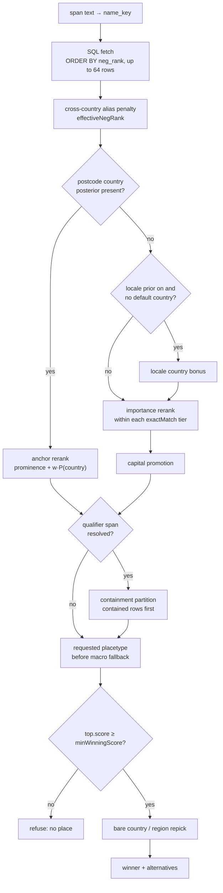
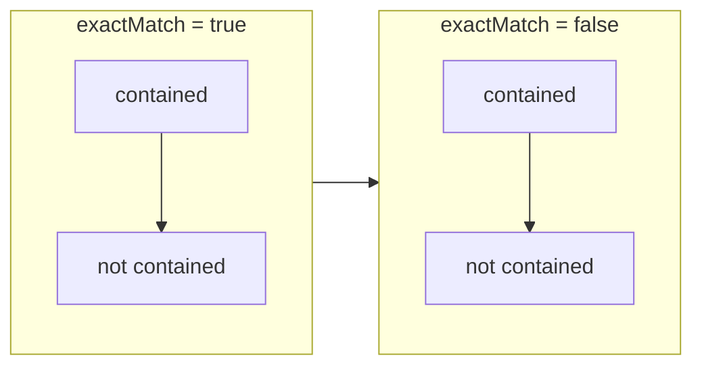

# Place ranking

For each admin span (`locality`, `region`, `country`, or another admin tag), the resolver finds
matching rows in `candidate.db`. A match has the same `name_key` as the normalized span text.

The resolver then applies a fixed sequence of sorting and grouping steps. There is no single score
that combines population, importance, country, and containment.

Venue rows in `poi.db` use a separate ranking process. See [The venue tier](#the-venue-tier).

## The ordering passes

These steps run in order in `resolveNode` (`packages/resolver/lib/resolve.ts`). Conditional steps
run only when the required input is available.

| pass              | sort key or rule                                                                   | input from the rest of the address            | source                                            |
| ----------------- | ---------------------------------------------------------------------------------- | --------------------------------------------- | ------------------------------------------------- |
| SQL fetch         | `neg_rank` ascending, `RERANK_FETCH = 64` rows                                     | none                                          | `resolver-wof-sqlite/lib/candidate/lookup.ts`     |
| Alias penalty     | `effectiveNegRank`, see below                                                      | none                                          | `resolver-wof-sqlite/lib/primary-preference.ts`   |
| Anchor rerank     | `exactMatch` tier, then prominence plus the postcode's country posterior           | the postcode span                             | `resolver/lib/resolve.ts`                         |
| Locale prior      | adds `DEFAULT_COUNTRY_PRIOR_WEIGHT = 2` to rows in the locale's country            | the session locale, set outside the address   | `resolver/lib/toponym-prior.ts`                   |
| Importance        | `importance` descending within each `exactMatch` tier                              | none                                          | `resolver/lib/toponym-prior.ts`                   |
| Capital promotion | a national capital may move ahead within `NATIONAL_CAPITAL_MARGIN_LOG10 = 2`       | none                                          | `capitalTier` in `runtime-flags.mdx`              |
| Containment       | rows inside the qualifier move ahead, within the `exactMatch` tier                 | the parsed region, country or parent locality | `partitionByContainment`                          |
| Placetype         | the requested placetype precedes a macro fallback                                  | the span's own tag                            | `resolver/lib/resolve.ts`                         |
| Floor and repicks | refuse below `minWinningScore`; a bare country or region replaces a weaker top row | none                                          | `resolver/lib/resolve.ts`, `bare-toponym-race.ts` |

The anchor rerank and importance pass are alternatives. If a postcode provides a country
posterior, the resolver uses the anchor rerank and skips the locale prior, importance pass, and
capital promotion.

## Population: the referential score

Population affects the referential score. That score ranges from 0 to 1. The formula is defined in
`packages/core/lib/resolver/referential.ts`:

<math display="block">
	<mrow>
		<mi>r</mi>
		<mo>(</mo>
		<mi>p</mi>
		<mo>)</mo>
		<mo>=</mo>
		<mo>min</mo>
		<mo>(</mo>
		<mn>1</mn>
		<mo>,</mo>
		<mfrac>
			<mrow>
				<msub>
					<mi>log</mi>
					<mn>2</mn>
				</msub>
				<mo>(</mo>
				<mn>1</mn>
				<mo>+</mo>
				<mfrac>
					<mi>p</mi>
					<mn>1000</mn>
				</mfrac>
				<mo>)</mo>
			</mrow>
			<mn>14</mn>
		</mfrac>
		<mo>)</mo>
	</mrow>
</math>

The score reaches 1.0 at a population of

<math>
	<mrow>
		<mo>(</mo>
		<msup>
			<mn>2</mn>
			<mn>14</mn>
		</msup>
		<mo>−</mo>
		<mn>1</mn>
		<mo>)</mo>
		<mo>·</mo>
		<mn>1000</mn>
		<mo>=</mo>
		<mn>16,383,000</mn>
	</mrow>
</math>
. Above that value, two cities tie, and `compareReferential` breaks the tie with raw population.

A row with no population and a row with population 0 both score 0. That score adds 0 to the
ranking key and applies a penalty of 0. WOF records population for only about 15% of localities, so
most rows have a score of 0.

The candidate backend's `score` is `−neg_rank`, a log-population rank that measured 5–7 on the 40
gold rows in [Resolver backends](./resolver-backends.mdx). `minWinningScore` checks this value, so
the floor it sets is a minimum population rank and holds no information about confidence.

## The cross-country alias penalty

An alias row (`is_primary = 0`) gets a penalty if the highest-ranked primary-name row with the
same key is in another country:

<math display="block">
  <mrow>
    <msub><mi>n</mi><mtext>eff</mtext></msub>
    <mo>=</mo>
    <msub><mi>n</mi><mtext>rank</mtext></msub>
    <mo>+</mo>
    <mrow>
      <mo>{</mo>
      <mtable>
        <mtr><mtd><mn>1</mn></mtd><mtd><mtext>alias, and the top primary row is in another country</mtext></mtd></mtr>
        <mtr><mtd><mn>0</mn></mtd><mtd><mtext>otherwise</mtext></mtd></mtr>
      </mtable>
    </mrow>
  </mrow>
</math>

The penalty is `PRIMARY_PREFERENCE_LOG10 = 1`, or one log10 population unit. An alias can still
win if it is at least ten times as populous as the primary row in the other country. This is why
`LA` still resolves to Los Angeles. A penalized row also loses `exactMatch`, so a later country
pin cannot promote it back into that tier.

## Importance

`candidate.db` stores `importance`, a blended value from 0 to 1. It is `NULL` when unmeasured.
Within each `exactMatch` tier, measured rows are ordered by importance.

There is one exception: same-country rows whose importance values differ by no more than
`SAME_COUNTRY_IMPORTANCE_TIE_BAND = 0.02` are ordered by size instead. Populated places come
first. Rows with no importance value keep their existing positions.

Encyclopedic importance is one component of the blend. It is stored as data, but never used on its
own as a ranking key (ROAD_TO_V9 §2 R1, ratified 2026-08-06).

Saint-Denis illustrates why. The Aude hamlet has 418 people and encyclopedic importance 0.5683.
The Seine-Saint-Denis suburb has 96,128 people and importance 0.1173. An order by encyclopedic
importance with no other signal would put the hamlet first.

## Where the other spans enter

Two ranking steps can use other parts of the address: the postcode's country and a parent-place
qualifier.

**Postcode country.** When a `region` or `locality` has multiple candidates, the resolver uses
the postcode's country posterior to calculate each row's key:

<math display="block">
	<mrow>
		<mi>k</mi>
		<mo>=</mo>
		<mi>prominence</mi>
		<mo>+</mo>
		<mi>w</mi>
		<mo>·</mo>
		<mi>P</mi>
		<mo>(</mo>
		<mi>country</mi>
		<mo>∣</mo>
		<mi>postcode</mi>
		<mo>)</mo>
	</mrow>
</math>

By default, `anchorWeight` is <math><mi>w</mi><mo>=</mo><mn>2</mn></math>. A row in a country not
listed in the posterior gets 0 from the posterior term. The resolver compares `exactMatch` tiers
before comparing these keys.

**Parent-place containment.** An address may include a parent place, such as the region in
`Weimar, Thüringen`. The lookup uses the ancestors sidecar (`candidate_interval`,
`candidate_ancestor`) to mark matching rows as `containedByQualifier`.

It also adds same-key rows inside the qualifier that were outside the country scope. Within each
`exactMatch` tier, all contained rows come before all uncontained rows, regardless of population.
For example, a contained place with 200 people comes before an uncontained place with 2 million.

Without the ancestors sidecar, the backend cannot determine containment. The pick's
`metadata.admin_containment` then reads `unavailable`. The flag that controls the pass is
`adminContainmentRerank` in [Runtime flags](./runtime-flags.mdx).

## Examples

Each example below gives the input, the competing `candidate.db` rows, and the place `mailwoman
geocode` returned under the default `en-US` locale on 2026-10-11. The rows come from
`mwdev_lookup source=candidate` against `/mnt/mw/db/wof/candidate.db`, in fetch order
(`neg_rank`, population first). The pass listed as deciding each case is read from the rows and the
pass order. These runs did not record per-pass traces.

### A bare name across countries: `Saint-Denis`

The key `saint-denis` holds 65 rows. The first four by population are:

| row                | country | placetype  | population | `importance` |
| ------------------ | ------- | ---------- | ---------: | -----------: |
| Saint-Denis        | RE      | locality   |    154,765 |       0.5202 |
| Saint-Denis        | FR      | localadmin |    111,135 |       0.4864 |
| Saint-Denis        | FR      | locality   |     96,128 |       0.4716 |
| Saint-Denis-en-Val | FR      | locality   |      7,632 |       0.4721 |

The address has no postcode or qualifier. The importance pass orders countries by their best
row, and Réunion's 0.5202 leads France's 0.4864. The geocoder returns Saint-Denis, Réunion
(-20.8823, 55.4504). The Seine-Saint-Denis suburb that most French readers mean needs a qualifier
or a postcode.

### The same-country tie band: `Springfield`

The key `springfield` holds 313 rows. The three largest US localities are:

| row                        | population | `importance` |
| -------------------------- | ---------: | -----------: |
| Springfield, Missouri      |    171,589 |       0.5962 |
| Springfield, Massachusetts |    153,672 |       0.6111 |
| Springfield, Illinois      |    112,544 |       0.6126 |

Illinois has the highest importance. All three are in one country, and adjacent values differ by
0.0015 (Illinois to Massachusetts) and 0.0149 (Massachusetts to Missouri). Both gaps are within
`SAME_COUNTRY_IMPORTANCE_TIE_BAND = 0.02`, so the three rows form one cluster, and the cluster is
ordered by size. The geocoder returns Springfield, Missouri (37.1973, -93.2807).

`Springfield, IL` returns Springfield, Illinois (39.7973, -89.6455). The parsed region `IL` makes
the containment pass move the Illinois row ahead of the larger Missouri row.

### A qualifier overrides importance: `Weimar, Texas`

| row           | country | population | `importance` |
| ------------- | ------- | ---------: | -----------: |
| Weimar        | DE      |     65,228 |       0.6691 |
| Weimar (Lahn) | DE      |      7,167 |       0.4144 |
| Weimar        | US      |      2,152 |       0.3683 |

A bare `Weimar` returns Weimar, Germany (50.9860, 11.3221). `Weimar, Texas` returns Weimar,
Texas (29.7000, -96.7807). The Texas row is 30 times smaller and has a lower importance. It wins
because it is the only row contained by the parsed region `Texas`, and containment is a partition.

### The placetype pass and the alias penalty: `LA`

The key `la` holds 28 rows. The first three are:

| row         | country | placetype | population | `is_primary` | `importance` |
| ----------- | ------- | --------- | ---------: | -----------: | -----------: |
| Louisiana   | US      | region    |  4,573,749 |            0 |       0.8685 |
| Los Angeles | US      | locality  |  3,820,914 |            0 |       0.8500 |
| La          | GH      | locality  |     98,683 |            1 |       0.4742 |

The top primary-name row is La, Ghana, so both US rows are aliases of a key whose primary row is
in another country. The penalty adds one log10 unit to each. Los Angeles is

<math>
	<mrow>
		<mn>3,820,914</mn>
		<mo>/</mo>
		<mn>98,683</mn>
		<mo>≈</mo>
		<mn>39</mn>
	</mrow>
</math>
times as populous as La, Ghana, so it stays ahead after the penalty.

The parser tags `LA` as a `locality`. Louisiana leads on population and importance, but it is a
`region`, and the placetype pass puts the requested placetype first. The geocoder returns Los
Angeles (34.0551, -118.2570).

### Placetype among same-name rows: `Paris` and `Paris, TX`

| row   | country | placetype  | population | `importance` |
| ----- | ------- | ---------- | ---------: | -----------: |
| Paris | FR      | localadmin |  2,187,526 |       0.7926 |
| Paris | FR      | locality   |  2,138,551 |       0.8971 |
| Paris | FR      | region     |  2,117,702 |       0.8971 |
| Paris | US      | locality   |     24,969 |       0.5299 |

The `localadmin` row is fetched first by population. The `locality` row has the higher importance
and the requested placetype, and `Paris` returns it (48.8587, 2.3429). `Paris, TX` returns Paris,
Texas (33.6593, -95.5616) through the containment pass, as `Weimar, Texas` does.

## The venue tier

Venue rows follow a separate process in `packages/mailwoman/lib/fork-entity.ts`. The only
per-row score is Overture's `confidence`: the probability that the place exists. It is stored as

<math display="block">
	<mrow>
		<mi>neg_rank</mi>
		<mo>=</mo>
		<mo>−</mo>
		<msub>
			<mi>log</mi>
			<mn>10</mn>
		</msub>
		<mo>(</mo>
		<mi>confidence</mi>
		<mo>+</mo>
		<msup>
			<mn>10</mn>
			<mn>−6</mn>
		</msup>
		<mo>)</mo>
	</mrow>
</math>

Rows with the same name key and within `SAME_ENTITY_M = 150` meters count as one venue. The most
confident row represents that venue.

- **Without an anchor**, `probeForkEntity` answers only when exactly one distinct venue worldwide
  has the name key. `Buckingham Palace` has two (a park row in London and a cabin row in
  Tennessee), so it returns `null`.
- **With an anchor**, the probe keeps venues within a radius of the anchor and takes the most
  confident one. The radius depends on the anchor: it is wider for a locality and narrower for a
  unit-grade postcode.

The venue tier has no prominence signal. `confidence` measures whether a venue exists, and the
values sit close together for venues of very different fame: the Tennessee cabin scores 0.92, and
the palace scores 0.99.

To rank an unanchored venue by prominence, the tier would need a field such as the venue's own Wikidata
ID and sitelink count. `poi.db` stores `brand_wikidata`, but not the venue's own Wikidata ID.
